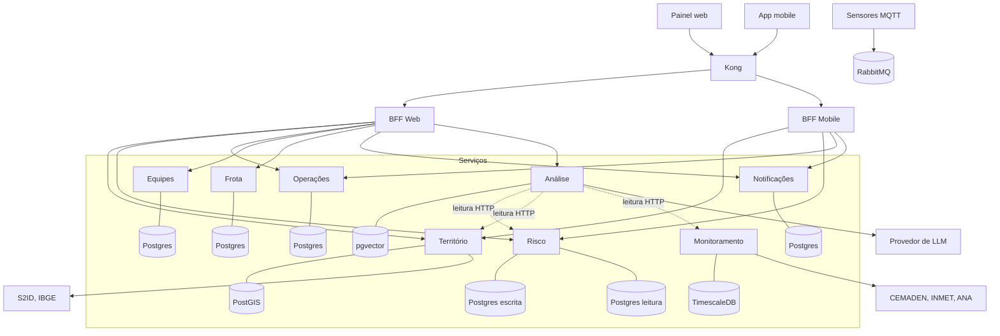
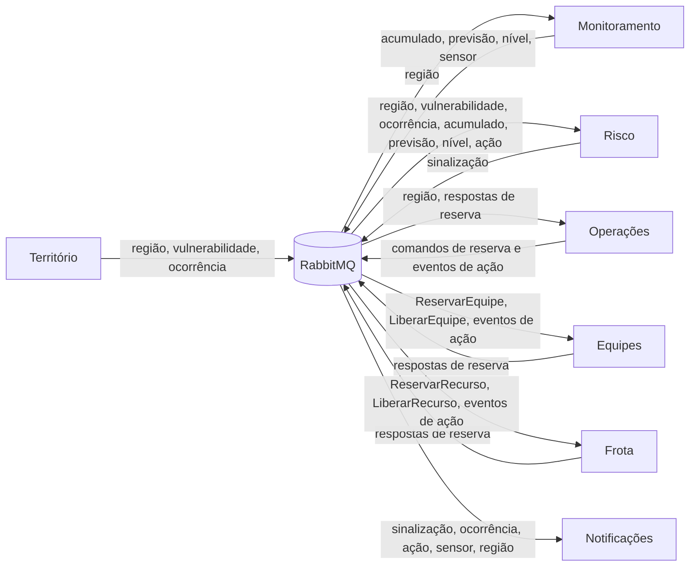

# 4.1 Decomposição em microsserviços

## Critérios de decomposição

As fronteiras foram traçadas por **capacidade de negócio**, e não por camada técnica. Quatro critérios orientaram cada corte:

1. **Dono do dado.** Cada serviço é a fonte da verdade de um conjunto de dados e ninguém mais o altera.
2. **Taxa de mudança.** Dados que mudam juntos ficam juntos; dados com ritmos muito diferentes ficam separados.
3. **Exigência de consistência.** Onde uma regra exige consistência forte (reserva de recurso disputado), a regra inteira fica dentro de um único serviço.
4. **Isolamento de falha.** Dependências externas instáveis (fontes públicas, provedor de LLM) ficam isoladas em serviços próprios, para que sua indisponibilidade não derrube o restante.

---

## Serviços de domínio

### 1. Território

| | |
|---|---|
| **Responsabilidade** | Cadastro das regiões monitoradas, suas características físicas e indicadores de vulnerabilidade. Registro de ocorrências, tanto as importadas do S2ID quanto as reportadas em campo, e sua validação técnica. |
| **Dados que possui** | Regiões e geometria, características, vulnerabilidade, ocorrências |
| **Publica** | `RegiaoCadastrada`, `RegiaoAtualizada`, `VulnerabilidadeAtualizada`, `OcorrenciaReportada`, `OcorrenciaValidada`, `OcorrenciaDescartada` |
| **Consome** | Nenhum evento |
| **Não faz** | Não avalia risco nem define nível de atenção |
| **Banco** | PostgreSQL com PostGIS |

### 2. Monitoramento

| | |
|---|---|
| **Responsabilidade** | Ingestão de chuva observada (CEMADEN), previsão meteorológica (INMET), níveis de corpos d'água (ANA) e leituras dos sensores de nível. Cálculo de acumulados por região e janela de tempo. Detecção de sensor sem comunicação. |
| **Dados que possui** | Estações, sensores, séries de leituras, acumulados, boletins de previsão |
| **Publica** | `AcumuladoAtualizado`, `PrevisaoPublicada`, `NivelAtualizado`, `SensorInativo` |
| **Consome** | `RegiaoCadastrada`, `RegiaoAtualizada` |
| **Não faz** | Não interpreta os dados nem decide se um volume é preocupante |
| **Banco** | PostgreSQL com TimescaleDB |

### 3. Risco

| | |
|---|---|
| **Responsabilidade** | Composição do panorama de cada região e do cenário previsto, a partir dos dados de Território, Monitoramento e Operações. Emissão, reconhecimento e encerramento de sinalizações de atenção. |
| **Dados que possui** | Parâmetros de avaliação por região, sinalizações (escrita). Panorama consolidado por região (leitura). |
| **Publica** | `SinalizacaoEmitida`, `SinalizacaoReconhecida`, `SinalizacaoEncerrada` |
| **Consome** | Eventos de região, vulnerabilidade, ocorrência, acumulado, previsão, nível, sensor e ação preventiva |
| **Não faz** | Não produz previsão meteorológica própria e não afirma que haverá alagamento |
| **Banco** | PostgreSQL para escrita e PostgreSQL separado para o modelo de leitura (CQRS, ver [07-cqrs.md](07-cqrs.md)) |

### 4. Operações

| | |
|---|---|
| **Responsabilidade** | Ciclo de vida das ações preventivas: solicitação, confirmação, execução, conclusão e cancelamento. **Orquestrador da SAGA** de abertura de ação. |
| **Dados que possui** | Ações preventivas, estado das SAGAs, outbox |
| **Publica** | `AcaoPreventivaConfirmada`, `AcaoPreventivaRejeitada`, `AcaoPreventivaIniciada`, `AcaoPreventivaConcluida`, `AcaoPreventivaCancelada`. Comandos: `ReservarEquipe`, `LiberarEquipe`, `ReservarRecurso`, `LiberarRecurso` |
| **Consome** | `RegiaoCadastrada`, `RegiaoAtualizada`. Respostas das reservas de Equipes e Frota |
| **Não faz** | Não decide qual equipe ou veículo está disponível; pede a quem é dono do recurso |
| **Banco** | PostgreSQL |

### 5. Equipes

| | |
|---|---|
| **Responsabilidade** | Cadastro de equipes de campo, especialidades, indisponibilidades e **reserva de equipe por data e turno**, garantindo que a mesma equipe não seja alocada duas vezes no mesmo turno. |
| **Dados que possui** | Equipes, indisponibilidades, reservas de equipe |
| **Publica** | Respostas: `EquipeReservada`, `ReservaEquipeRecusada`, `EquipeLiberada` |
| **Consome** | Comandos `ReservarEquipe`, `LiberarEquipe`. Eventos `AcaoPreventivaConfirmada`, `AcaoPreventivaConcluida`, `AcaoPreventivaCancelada` |
| **Banco** | PostgreSQL |

### 6. Frota

| | |
|---|---|
| **Responsabilidade** | Cadastro de veículos e equipamentos, períodos de manutenção e **reserva de recurso por data e turno**. |
| **Dados que possui** | Recursos, manutenções, reservas de recurso |
| **Publica** | Respostas: `RecursoReservado`, `ReservaRecursoRecusada`, `RecursoLiberado` |
| **Consome** | Comandos `ReservarRecurso`, `LiberarRecurso`. Eventos `AcaoPreventivaConfirmada`, `AcaoPreventivaConcluida`, `AcaoPreventivaCancelada` |
| **Banco** | PostgreSQL |

---

## Serviços de apoio

### Notificações

Envia **alertas operacionais internos** à equipe técnica e aos agentes cadastrados. Não emite alerta à população. Mantém as inscrições de cada usuário por região e nível mínimo de atenção.

- **Consome:** `SinalizacaoEmitida`, `OcorrenciaReportada`, `AcaoPreventivaConfirmada`, `AcaoPreventivaRejeitada`, `AcaoPreventivaCancelada`, `SensorInativo`, `RegiaoCadastrada`
- **Banco:** PostgreSQL

### Análise

Camada de IA. Produz sínteses explicáveis da situação atual e do cenário previsto de uma região, e responde consultas à base de conhecimento por recuperação aumentada (RAG). Detalhado na Parte 4.

- **Consulta por HTTP, somente leitura:** Risco, Território e Monitoramento
- **Banco:** PostgreSQL com pgvector
- **Tecnologia:** Python com FastAPI e LangChain

---

## Borda

| Componente | Papel |
|---|---|
| **API Gateway (Kong)** | Ponto único de entrada. Roteia para os BFFs, valida JWT, aplica rate limiting. Ver [03-gateway.md](03-gateway.md) |
| **BFF Web** | Compõe as respostas para o painel da equipe técnica. Ver [04-bff.md](04-bff.md) |
| **BFF Mobile** | Compõe respostas enxutas para agentes em campo e comunidade |

---

## Por que este corte e não outro

As alternativas abaixo foram consideradas e rejeitadas.

| Alternativa | Por que foi rejeitada |
|---|---|
| **Juntar Equipes e Frota num serviço de Recursos** | São recursos com donos e regras diferentes. Equipe tem especialidade, turno e afastamento; veículo tem manutenção e categoria. Separados, a reserva de cada um tem consistência forte dentro do próprio serviço, e a abertura de ação passa a exigir coordenação entre três serviços, o que é exatamente o problema real de alocar pessoas e máquinas de setores diferentes. |
| **Separar Ocorrências de Território** | Toda ocorrência pertence a uma região, e o histórico de ocorrências é o que caracteriza um território como de risco. Os dois são consultados juntos e mudam juntos. A validação de ocorrência não compromete recurso de nenhum outro serviço, então não justifica fronteira própria. |
| **Avaliar risco dentro de Monitoramento** | Monitoramento ingere e calcula; Risco interpreta e decide. Têm ritmos distintos: a ingestão roda continuamente, a interpretação muda quando mudam as regras. Além disso, Risco consome dados de quatro origens, não só de Monitoramento, e tem perfil de leitura intenso que justifica CQRS. |
| **Colocar a IA dentro de Risco** | O provedor de LLM é uma dependência remota lenta e falível. Isolado, ele pode cair sem derrubar o panorama de risco. Também permite usar Python, onde o ecossistema de LangChain e RAG é mais maduro. |
| **Colocar notificações dentro de Operações** | Notificações nascem de várias origens: sinalizações de Risco, sensores de Monitoramento, ocorrências de Território e ações de Operações. Centralizar em Operações criaria dependência de todos para um. |
| **Um serviço por fonte externa** | Criaria vários serviços com a mesma responsabilidade: ingerir série temporal e associar a uma região. Monitoramento trata cada fonte como um adaptador interno. |

---

## Diagrama de componentes

---

## Diagrama de comunicação assíncrona

---

## Matriz de comunicação

| Origem | Destino | Tipo | Finalidade |
|---|---|---|---|
| Clientes | Kong | HTTP | Toda requisição externa |
| Kong | BFF Web, BFF Mobile | HTTP | Roteamento por prefixo |
| BFFs | Serviços de domínio e apoio | HTTP | Consultas e comandos do usuário |
| Serviços de domínio | Serviços de domínio | Mensagens | Eventos e comandos da SAGA |
| Sensores | RabbitMQ | MQTT | Leituras de nível |
| Análise | Risco, Território, Monitoramento | HTTP, somente leitura | Ferramentas consultadas pelo LLM |
| Análise | Provedor de LLM | HTTP | Geração de texto e embeddings |

### A exceção da Análise

A regra geral é que serviços não se chamam por HTTP. A Análise é exceção deliberada: ela funciona como um **cliente de leitura**, que consulta dados atuais sob demanda para compor uma resposta do LLM. Manter réplicas locais de todos os dados de outros três serviços só para uso ocasional seria desproporcional. Como as chamadas são somente leitura, não há risco de inconsistência de escrita, e a indisponibilidade de um serviço consultado degrada apenas a análise, não o restante do sistema.
