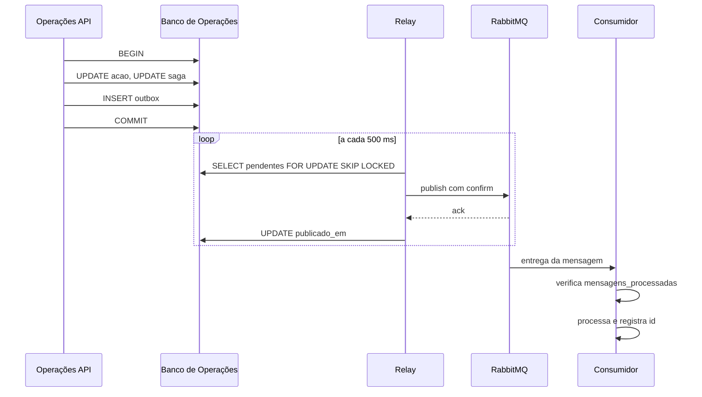

# 4.5 Database per service

## Um banco por serviço

Cada serviço tem sua **própria instância** de PostgreSQL. Nenhum serviço acessa o banco de outro, nem para leitura. Quando um serviço precisa de um dado alheio, ele o recebe por evento e guarda uma cópia local mínima.

| Serviço | Tecnologia | Justificativa |
|---|---|---|
| **Território** | PostgreSQL + **PostGIS** | Regiões são polígonos. Localizar a região de uma coordenada (`ST_Contains`), usado quando o app mobile pergunta "qual é a minha região", é consulta espacial nativa do PostGIS |
| **Monitoramento** | PostgreSQL + **TimescaleDB** | Leituras são séries temporais de alta frequência. Hypertables particionam por tempo automaticamente, e *continuous aggregates* mantêm os acumulados de 1 h, 24 h e 72 h pré-calculados, sem recalcular a cada consulta |
| **Risco, escrita** | PostgreSQL | Sinalizações e parâmetros têm regra de transição e exigem transação |
| **Risco, leitura** | PostgreSQL, instância separada, com **JSONB** | Modelo de leitura desnormalizado: um documento por região. JSONB dá flexibilidade de documento sem introduzir outra tecnologia. Instância separada para que a carga de leitura dos painéis não concorra com a escrita |
| **Operações** | PostgreSQL | A ação, o estado da SAGA e a outbox precisam ser gravados **na mesma transação**. Isso exige banco relacional com ACID |
| **Equipes** | PostgreSQL | A regra "uma equipe não pode ter duas reservas ativas no mesmo turno" é garantida por **índice único parcial**, à prova de concorrência |
| **Frota** | PostgreSQL | Mesma garantia para veículos e equipamentos, mais **restrição de exclusão** para impedir reserva sobreposta a manutenção |
| **Notificações** | PostgreSQL | Caixa de entrada e inscrições; volume baixo, modelo simples |
| **Análise** | PostgreSQL + **pgvector** | Armazena os embeddings da base de conhecimento para a busca por similaridade do RAG |

### Por que PostgreSQL em todos

O enunciado permite bancos diferentes por serviço, e isso foi considerado. A decisão foi usar PostgreSQL em todos, variando as **extensões** conforme a necessidade de cada serviço. Cada necessidade específica (espacial, série temporal, vetorial, documento) é atendida por uma extensão madura, e o grupo opera uma única tecnologia de banco. O isolamento continua total: são instâncias separadas, com credenciais separadas, e trocar o banco de um serviço no futuro não afeta nenhum outro.

### Garantias de reserva no próprio banco

Em **Equipes**:

```sql
CREATE UNIQUE INDEX reserva_equipe_ativa
  ON reservas (equipe_id, data, turno)
  WHERE estado IN ('PROVISORIA', 'CONFIRMADA');
```

Em **Frota**, além do índice equivalente:

```sql
ALTER TABLE manutencoes
  ADD CONSTRAINT manutencao_sem_sobreposicao
  EXCLUDE USING gist (recurso_id WITH =, periodo WITH &&);
```

Duas SAGAs concorrentes tentando reservar a mesma equipe no mesmo turno não dependem de verificação na aplicação: uma das inserções falha no banco, e o serviço responde `ReservaEquipeRecusada`. Isso elimina a condição de corrida entre "verificar disponibilidade" e "reservar".

---

## Dados replicados

| Serviço | Guarda cópia de | Recebida por | Uso |
|---|---|---|---|
| Monitoramento | Id, nome e município das regiões | `RegiaoCadastrada`, `RegiaoAtualizada` | Associar estações e previsões às regiões |
| Risco | Região, vulnerabilidade, ocorrências agregadas, acumulados, previsão, ações abertas | Eventos de todos esses tipos | Compor o panorama |
| Operações | Id e nome das regiões | `RegiaoCadastrada`, `RegiaoAtualizada` | Validar que a região existe ao criar a ação, sem chamar Território |
| Notificações | Id e nome das regiões | `RegiaoCadastrada`, `RegiaoAtualizada` | Montar o texto dos alertas |

A cópia é **somente leitura** para quem a guarda. O dono continua sendo o serviço de origem.

---

## Pontos de consistência eventual

| Ponto | O que fica defasado | Defasagem aceitável | Por que é aceitável |
|---|---|---|---|
| **Panorama de risco** | Modelo de leitura em relação aos dados de origem | Até 30 s | O panorama apoia planejamento em horizonte de horas. Cada resposta traz `atualizadoEm` |
| **Cenário previsto** | Painel em relação a um novo boletim do INMET | Até 5 min | Boletins são publicados poucas vezes por dia |
| **Ação durante a SAGA** | Estado `PENDENTE` visível até a conclusão das reservas | Até 60 s, limite do timeout | O estado intermediário é explícito e o cliente não pode agir sobre ele |
| **Reservas provisórias** | Reserva em `PROVISORIA` até receber `AcaoPreventivaConfirmada` | Segundos | A reserva provisória já bloqueia o turno, então não há risco de dupla alocação |
| **Cópias de região** | Nome ou dados de região nos serviços consumidores | Até 30 s | Mudança cadastral de região é rara |
| **Alertas operacionais** | Entrega do alerta após a sinalização | Até 30 s | Alerta interno de planejamento, não de emergência |
| **Ocorrência validada no panorama** | Contagem de ocorrências no panorama | Até 30 s | Histórico de longo prazo; segundos não mudam decisão |

---

## Risco de dual write

Há dual write sempre que um serviço precisa **gravar no próprio banco e publicar uma mensagem** como parte da mesma operação. Se a gravação acontece e a publicação falha, o sistema fica inconsistente; se a publicação acontece e a gravação falha, outros serviços reagem a algo que não existiu.

| Onde | Operação | Consequência se falhar pela metade | Tratamento |
|---|---|---|---|
| **Operações** | Grava ação e estado da SAGA, envia comando de reserva | Ação eternamente `PENDENTE`, ou equipe reservada para ação inexistente | **Outbox** (projetado abaixo) |
| **Operações** | Confirma ação, publica `AcaoPreventivaConfirmada` | Reservas nunca saem de `PROVISORIA`; equipe designada não é avisada | **Outbox** |
| **Equipes, Frota** | Grava reserva, responde à SAGA | Orquestrador não recebe resposta e compensa; reserva fica órfã | **Outbox**, mesma biblioteca de Operações, e expiração de reserva provisória como rede de segurança |
| **Território** | Valida ocorrência, publica `OcorrenciaValidada` | Panorama não reflete a ocorrência | **Outbox** |
| **Risco** | Emite sinalização, publica `SinalizacaoEmitida` | Alerta operacional não é enviado | **Outbox** |
| **Monitoramento** | Grava leitura, publica `AcumuladoAtualizado` | Panorama fica com acumulado antigo | **Republicação periódica**, sem outbox |
| **Notificações** | Apenas consome | Não há dual write | Consumo idempotente |

### Por que Monitoramento não usa outbox

O acumulado é **dado derivado e recalculável**. Se uma publicação se perde, basta publicar o valor atual de novo. Monitoramento republica o acumulado corrente de cada região a cada minuto, independentemente de ter havido mudança. Uma mensagem perdida é corrigida no minuto seguinte. Isso é mais barato que uma outbox para o fluxo de maior volume do sistema, e mostra que nem todo dual write exige o mesmo tratamento: exige análise de consequência.

---

## Padrão outbox em Operações

### Tabelas

```sql
CREATE TABLE outbox (
  id             uuid PRIMARY KEY,
  agregado_tipo  text        NOT NULL,
  agregado_id    uuid        NOT NULL,
  tipo_mensagem  text        NOT NULL,
  exchange       text        NOT NULL,
  routing_key    text        NOT NULL,
  payload        jsonb       NOT NULL,
  criado_em      timestamptz NOT NULL DEFAULT now(),
  publicado_em   timestamptz,
  tentativas     int         NOT NULL DEFAULT 0,
  ultimo_erro    text
);

CREATE INDEX outbox_pendentes ON outbox (criado_em) WHERE publicado_em IS NULL;

CREATE TABLE mensagens_processadas (
  mensagem_id    uuid PRIMARY KEY,
  processada_em  timestamptz NOT NULL DEFAULT now()
);
```

### Gravação na mesma transação

```typescript
await dataSource.transaction(async (tx) => {
  await tx.update(Acao, acaoId, { estado: 'CONFIRMADA' });
  await tx.update(Saga, sagaId, { estado: 'CONCLUIDA' });
  await tx.insert(Outbox, {
    id: uuid(),
    agregadoTipo: 'Acao',
    agregadoId: acaoId,
    tipoMensagem: 'AcaoPreventivaConfirmada',
    exchange: 'pluvia.eventos',
    routingKey: 'operacoes.acao.confirmada',
    payload: envelope,
  });
});
```

Ou as três gravações acontecem, ou nenhuma. A publicação no broker **não** acontece aqui.

### Relay

Um processo dentro do próprio serviço de Operações, a cada 500 ms:

1. Abre transação e seleciona até 100 mensagens pendentes, em ordem de criação, com `FOR UPDATE SKIP LOCKED`.
2. Publica cada uma no RabbitMQ com **publisher confirms** ativado.
3. Ao receber a confirmação do broker, marca `publicado_em = now()`.
4. Em caso de erro, incrementa `tentativas` e registra `ultimo_erro`; a mensagem será tentada no próximo ciclo.
5. Confirma a transação.

Mensagens publicadas há mais de 7 dias são apagadas por rotina diária.



### Garantias e consequências

- **Entrega pelo menos uma vez.** Se o relay publica e cai antes de marcar `publicado_em`, a mensagem será publicada de novo. Duplicatas são esperadas.
- **Consumidores idempotentes.** Todo consumidor registra o `id` da mensagem em `mensagens_processadas` na mesma transação em que aplica o efeito. Mensagem já registrada é descartada.
- **Ordem por agregado.** Com um único relay ativo por instância e seleção por `criado_em`, as mensagens de uma mesma ação saem na ordem em que foram geradas. Com várias réplicas do serviço, apenas uma executa o relay por vez, coordenada por *advisory lock* do PostgreSQL.

### Alternativa considerada

**Captura de mudanças com Debezium**, lendo o log de transações do PostgreSQL. Elimina o polling e reduz a latência, mas exige Kafka Connect e mais três componentes para operar. Para o volume da Pluvia, o polling a cada 500 ms é suficiente e muito mais simples.
