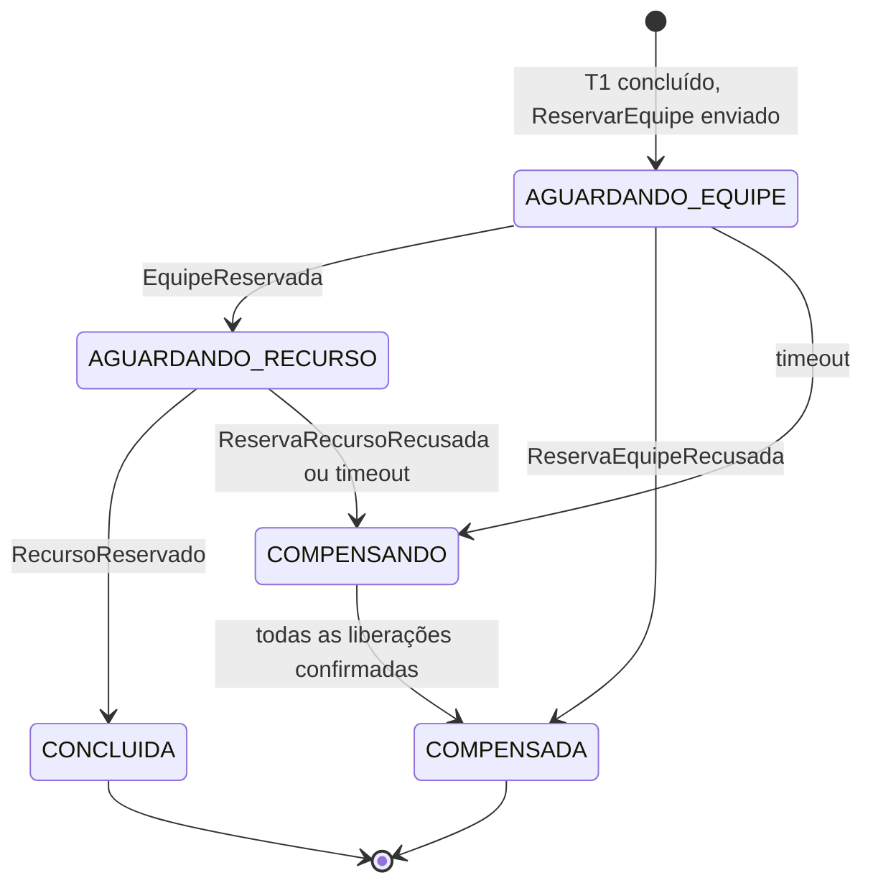
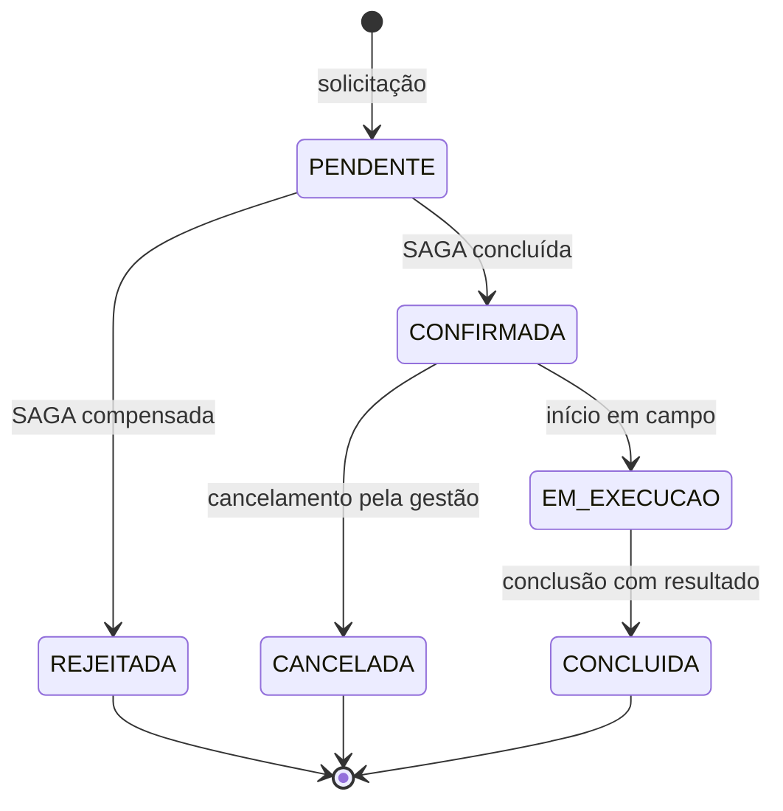
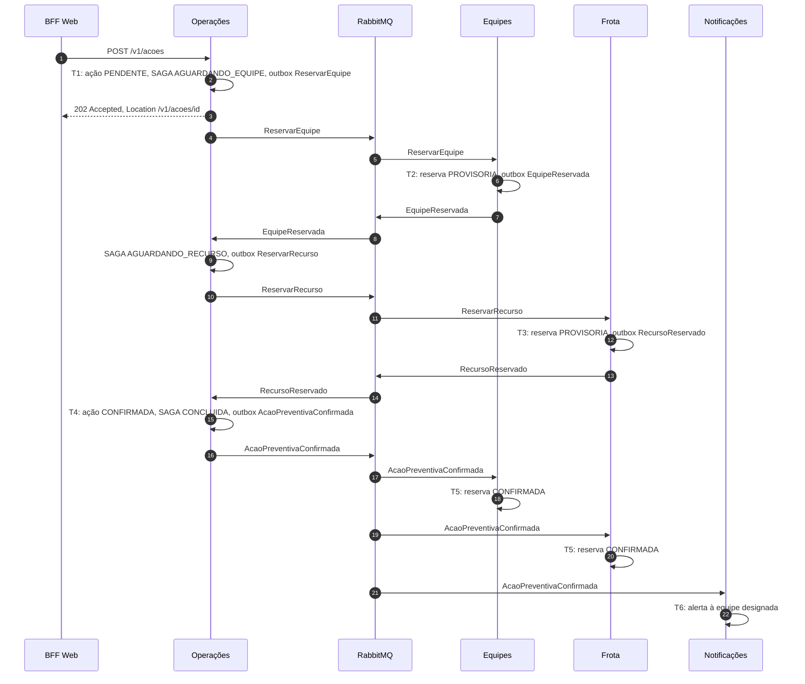
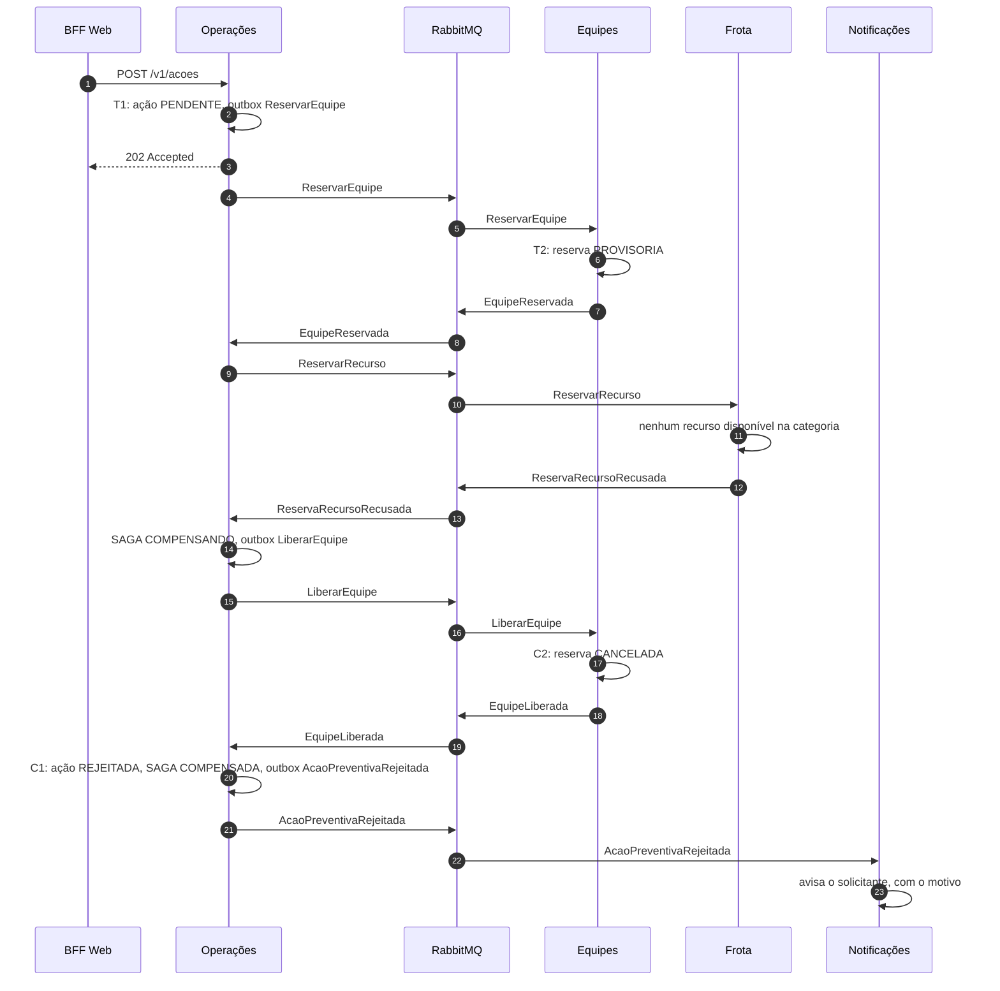
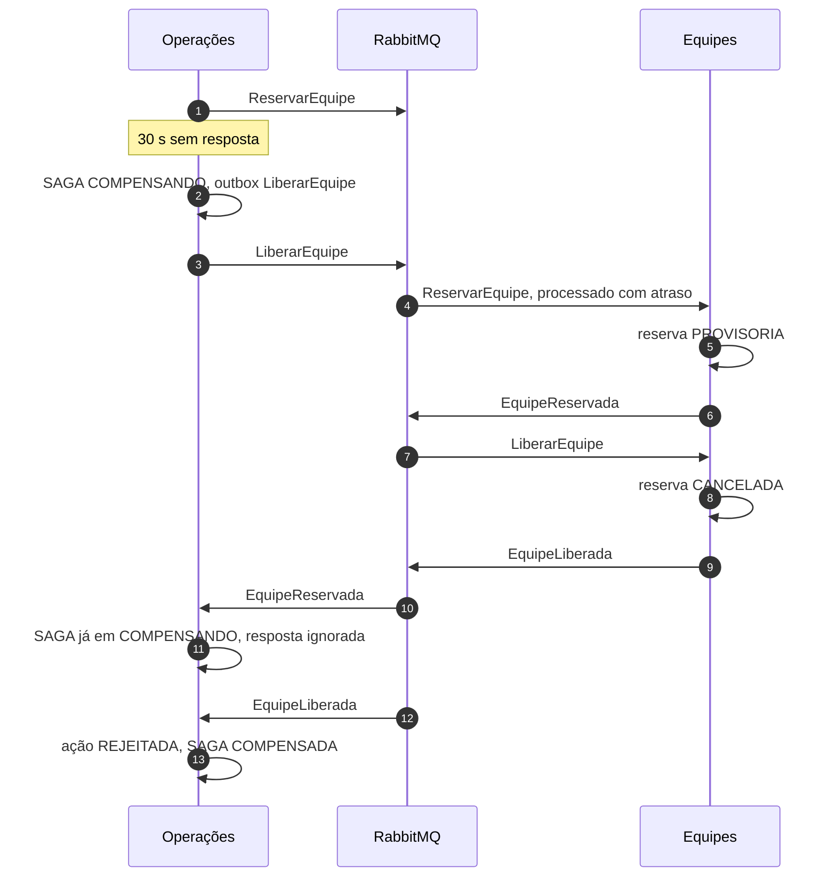

# 4.6 SAGA

## Transação de negócio

**Abertura de ação preventiva.** Uma equipe técnica decide agir numa região: abrir uma limpeza de drenagem para amanhã de manhã, por exemplo. Para que a ação seja viável, três coisas precisam acontecer juntas:

1. a ação é registrada (**Operações**);
2. uma equipe com a especialidade certa é reservada para aquele turno (**Equipes**);
3. um veículo ou equipamento da categoria necessária é reservado para o mesmo turno (**Frota**).

Se qualquer uma falhar, as outras precisam ser desfeitas. Uma equipe reservada sem veículo fica parada; um caminhão reservado sem equipe fica ocioso. Num município com poucos recursos, manter uma reserva inútil impede outra ação de acontecer.

Como cada recurso pertence a um serviço com banco próprio, não existe transação distribuída disponível. A SAGA coordena uma sequência de transações locais, cada uma com sua compensação.

---

## Variante escolhida: orquestrada

O serviço de **Operações** é o orquestrador. Ele mantém o estado de cada SAGA no próprio banco, envia comandos a Equipes e Frota e decide, a partir das respostas, se avança ou compensa.

### Por que orquestrada, e não coreografada

| Critério | Orquestrada | Coreografada |
|---|---|---|
| **Onde está o fluxo** | Num único lugar, a máquina de estados de Operações | Espalhado nos consumidores de eventos de três serviços |
| **Compensação** | Decidida por quem conhece o estado completo | Cada serviço precisa inferir o que desfazer a partir dos eventos que viu |
| **Acoplamento** | Equipes e Frota não se conhecem, só respondem a comandos | Frota precisaria reagir a eventos de Equipes, e vice-versa |
| **Observabilidade** | Estado da SAGA consultável em `GET /v1/acoes/{id}/saga` | Estado precisa ser reconstruído a partir de logs de vários serviços |
| **Demonstração** | Falha e compensação visíveis numa única tela | Exige correlacionar eventos de três lugares ao vivo |

Três fatores tornaram a escolha clara:

- **A ação preventiva já tem uma máquina de estados explícita** (`PENDENTE`, `CONFIRMADA`, `REJEITADA`). O orquestrador é a extensão natural dela.
- **A ordem importa.** Reservar a equipe antes do veículo é deliberado: equipe especializada é o recurso mais escasso, e falhar cedo nela evita reservar veículo à toa. Na coreografia, impor ordem exige encadear eventos, o que acopla os participantes.
- **A compensação precisa de visão do todo.** Após um timeout, é preciso liberar só o que foi efetivamente reservado. Quem sabe disso é o orquestrador.

A desvantagem aceita é que Operações se torna ponto central do fluxo. Isso é mitigado porque o estado da SAGA é persistido: se Operações reiniciar no meio, retoma de onde parou.

---

## Passos e compensações

| Passo | Serviço | Transação | Compensação | Classificação |
|---|---|---|---|---|
| T1 | Operações | Criar ação em `PENDENTE` e iniciar SAGA | Marcar ação como `REJEITADA`, com motivo | Compensável |
| T2 | Equipes | Reservar equipe da especialidade pedida, para a data e turno, em `PROVISORIA` | `LiberarEquipe`: reserva passa a `CANCELADA` | Compensável |
| T3 | Frota | Reservar recurso da categoria pedida, para a data e turno, em `PROVISORIA` | `LiberarRecurso`: reserva passa a `CANCELADA` | Compensável |
| T4 | Operações | Marcar ação como `CONFIRMADA` e publicar `AcaoPreventivaConfirmada` | Não há | **Pivô** |
| T5 | Equipes, Frota | Passar reservas de `PROVISORIA` para `CONFIRMADA` | Não há | Repetível |
| T6 | Notificações | Avisar a equipe designada | Não há | Repetível |

**T4 é o pivô.** Antes dele, qualquer falha leva à compensação. Depois dele, a SAGA não volta atrás: T5 e T6 são repetidos até terem sucesso, porque são idempotentes e não podem falhar por regra de negócio.

Cancelar uma ação já confirmada não é compensação da SAGA; é uma nova operação de negócio, descrita adiante.

---

## Estados

### Estado da SAGA

### Estado da ação

---

## Comandos e respostas

Todos trafegam pelo exchange `pluvia.comandos`, com o envelope padrão descrito em [08-eventos.md](08-eventos.md). Cada comando carrega `sagaId`, usado pelos participantes como chave de idempotência.

| Mensagem | De | Para | Dados principais |
|---|---|---|---|
| `ReservarEquipe` | Operações | Equipes | `sagaId`, `acaoId`, `especialidade`, `equipeId` opcional, `data`, `turno` |
| `EquipeReservada` | Equipes | Operações | `sagaId`, `reservaId`, `equipeId` |
| `ReservaEquipeRecusada` | Equipes | Operações | `sagaId`, `motivo` |
| `ReservarRecurso` | Operações | Frota | `sagaId`, `acaoId`, `categoria`, `data`, `turno` |
| `RecursoReservado` | Frota | Operações | `sagaId`, `reservaId`, `recursoId` |
| `ReservaRecursoRecusada` | Frota | Operações | `sagaId`, `motivo` |
| `LiberarEquipe` | Operações | Equipes | `sagaId` |
| `EquipeLiberada` | Equipes | Operações | `sagaId` |
| `LiberarRecurso` | Operações | Frota | `sagaId` |
| `RecursoLiberado` | Frota | Operações | `sagaId` |

---

## Caminho feliz

---

## Cenário de falha: sem veículo disponível

A equipe foi reservada, mas Frota não tem recurso da categoria pedida no turno, porque o único caminhão hidrojato está em manutenção.

Ao final, a equipe volta a estar disponível para aquele turno, e a ação fica registrada como `REJEITADA` com o motivo `Nenhum recurso da categoria CAMINHAO_HIDROJATO disponível em 20/10, manhã`. Nada fica reservado à toa.

---

## Cenário de falha: timeout com resposta atrasada

Equipes está lento. O orquestrador não recebe resposta dentro do prazo e compensa. A resposta chega depois.

Esse cenário funciona porque os comandos são processados **na ordem em que chegam à fila** de Equipes, e porque `LiberarEquipe` é idempotente: liberar uma reserva que ainda não existe, ou que já foi liberada, é tratado como sucesso.

Se `LiberarEquipe` chegasse antes de `ReservarEquipe`, Equipes registraria o `sagaId` como liberado e recusaria a reserva posterior daquela mesma SAGA.

---

## Isolamento

SAGAs não têm isolamento: outros processos enxergam os estados intermediários. Duas contramedidas tratam isso.

**Bloqueio semântico na ação.** Enquanto a ação está `PENDENTE`, ela não aceita nenhuma transição. O recurso não oferece links de `iniciar` ou `cancelar` (ver HATEOAS em [02-api-rest.md](02-api-rest.md)), e chamadas diretas recebem `409 Conflict`. Isso impede que alguém cancele a ação enquanto as reservas ainda estão em curso.

**Reserva provisória com expiração.** As reservas nascem `PROVISORIA` e só se tornam `CONFIRMADA` ao receber `AcaoPreventivaConfirmada`. Uma reserva provisória já bloqueia o turno, então não há dupla alocação. E se o orquestrador falhar de forma irrecuperável, Equipes e Frota expiram automaticamente reservas provisórias com mais de 15 minutos. É uma rede de segurança: recurso nunca fica preso para sempre por uma SAGA abandonada.

---

## Idempotência

| Participante | Chave | Comportamento |
|---|---|---|
| Equipes, `ReservarEquipe` | `sagaId` | Se já existe reserva para a SAGA, responde de novo `EquipeReservada` com a mesma reserva |
| Equipes, `LiberarEquipe` | `sagaId` | Libera se existir; se não existir ou já estiver liberada, responde `EquipeLiberada` |
| Frota | `sagaId` | Mesmo comportamento |
| Operações, respostas | `sagaId` e estado atual | Resposta incompatível com o estado atual da SAGA é descartada |
| Todos, mensagem duplicada | `id` da mensagem | Registrado em `mensagens_processadas`; duplicata é ignorada |

---

## Operações posteriores à SAGA

Não fazem parte da SAGA, mas liberam os mesmos recursos:

| Operação | Evento | Efeito em Equipes e Frota |
|---|---|---|
| Cancelamento de ação confirmada | `AcaoPreventivaCancelada` | Reservas passam a `CANCELADA` |
| Conclusão de ação | `AcaoPreventivaConcluida` | Reservas passam a `ENCERRADA` |

Aqui a liberação é **coreografada**, por evento. Não há o que coordenar: liberar é idempotente e não pode falhar por regra de negócio, então não existe caminho de compensação.

---

## Como provocar a falha ao vivo na Parte 4

1. Consultar a frota e mostrar que existe um único caminhão hidrojato.
2. Registrar manutenção desse caminhão para o turno de amanhã: `POST /v1/recursos/{id}/manutencoes`.
3. Abrir uma ação de limpeza de drenagem para esse turno.
4. Mostrar a SAGA em `GET /v1/acoes/{id}/saga`: equipe reservada, recurso recusado, equipe liberada.
5. Consultar a disponibilidade da equipe e mostrar que o turno voltou a ficar livre.
