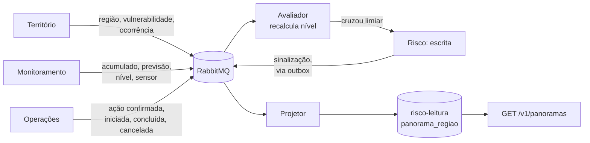

# 4.7 CQRS

## Onde: serviço de Risco

O serviço de Risco separa o **modelo de escrita**, onde vivem as regras sobre sinalizações e parâmetros de avaliação, do **modelo de leitura**, que é o panorama consolidado de cada região exibido nos painéis.

---

## Por que o Risco se beneficia da separação

**1. A leitura é muito mais frequente que a escrita.** O painel de gestão lista todas as regiões com seu nível de atenção e é aberto continuamente pela equipe técnica. O app mobile consulta o resumo da região de cada morador. Já a escrita, emissão ou reconhecimento de uma sinalização, acontece poucas vezes por dia.

**2. A leitura combina dados de quatro serviços.** Um panorama reúne região e vulnerabilidade (Território), ocorrências (Território), acumulados, previsão e níveis (Monitoramento), ações em andamento (Operações) e sinalizações (o próprio Risco). Montar isso a cada consulta exigiria juntar dados de várias origens sob demanda, o que é lento e acopla a disponibilidade do painel à de todos os serviços.

**3. Os formatos são diferentes.** A escrita é normalizada e orientada a regras: uma sinalização tem estado, transições e responsável. A leitura é um documento desnormalizado, pronto para exibir, com uma forma por tela.

**4. O cálculo é caro e não precisa ser refeito a cada leitura.** Comparar o acumulado com o percentil histórico local e combinar os fatores é feito uma vez, quando um dado muda, e não a cada vez que alguém abre o painel.

### Por que não aplicar CQRS em outros serviços

| Serviço | Por que não |
|---|---|
| Operações | Leitura e escrita têm a mesma forma: a própria ação. Separar só duplicaria o modelo |
| Equipes, Frota | A consulta de disponibilidade precisa de consistência forte com a reserva, que é justamente o que CQRS abre mão |
| Território | Volume de leitura baixo e cadastro simples |

Aplicar CQRS onde não há assimetria acrescenta complexidade sem ganho.

---

## Modelo de escrita

Instância `risco-escrita`, PostgreSQL normalizado.

```sql
CREATE TABLE parametros_avaliacao (
  regiao_id               uuid PRIMARY KEY,
  percentil_atencao       int  NOT NULL DEFAULT 85,
  percentil_alta_atencao  int  NOT NULL DEFAULT 95,
  peso_vulnerabilidade    numeric(3,2) NOT NULL DEFAULT 0.30,
  janela_historica_anos   int  NOT NULL DEFAULT 10,
  atualizado_em           timestamptz NOT NULL
);

CREATE TABLE sinalizacoes (
  id               uuid PRIMARY KEY,
  regiao_id        uuid NOT NULL,
  origem           text NOT NULL,   -- OBSERVADO | PREVISTO
  nivel_atencao    text NOT NULL,
  motivo           text NOT NULL,
  fatores          jsonb NOT NULL,
  estado           text NOT NULL,   -- ABERTA | RECONHECIDA | ENCERRADA
  emitida_em       timestamptz NOT NULL,
  reconhecida_por  uuid,
  reconhecida_em   timestamptz,
  encerrada_em     timestamptz
);
```

Os parâmetros são **por região**, e não globais, porque o mesmo acumulado significa coisas diferentes em territórios diferentes. É o princípio "sem regra fixa válida para todo território" da proposta.

**Comandos aceitos:**

| Endpoint | Efeito |
|---|---|
| `PUT /v1/regioes/{regiaoId}/parametros` | Altera parâmetros de avaliação da região |
| `POST /v1/sinalizacoes/{id}/reconhecimento` | Técnico reconhece a sinalização |
| `POST /v1/sinalizacoes/{id}/encerramento` | Técnico encerra a sinalização |

Sinalizações são **emitidas pelo próprio serviço**, não por comando externo: quando um evento de entrada muda a avaliação de uma região e ela cruza um limiar, o Risco grava a sinalização e publica `SinalizacaoEmitida` pela outbox.

---

## Modelo de leitura

Instância `risco-leitura`, PostgreSQL separado, com um documento JSONB por região.

```sql
CREATE TABLE panorama_regiao (
  regiao_id       uuid PRIMARY KEY,
  regiao_nome     text        NOT NULL,
  municipio       text        NOT NULL,
  nivel_atencao   text        NOT NULL,
  documento       jsonb       NOT NULL,
  versao          bigint      NOT NULL,
  atualizado_em   timestamptz NOT NULL
);

CREATE INDEX panorama_por_nivel ON panorama_regiao (nivel_atencao, municipio);

CREATE TABLE projecao_controle (
  regiao_id      uuid NOT NULL,
  fonte          text NOT NULL,         -- ACUMULADO | PREVISAO | OCORRENCIA | ...
  ultimo_evento  timestamptz NOT NULL,
  PRIMARY KEY (regiao_id, fonte)
);
```

As colunas `nivel_atencao` e `municipio` ficam fora do JSONB para permitir filtro e ordenação indexados no painel. O restante fica no documento.

**Consultas atendidas:**

| Endpoint | Leitura |
|---|---|
| `GET /v1/panoramas` | Lista de regiões com nível, ordenada por atenção |
| `GET /v1/panoramas/{regiaoId}` | Documento completo da região |
| `GET /v1/panoramas/{regiaoId}/cenario-previsto` | Trecho do documento referente à previsão |
| `GET /v1/sinalizacoes` | Lista de sinalizações, lida da escrita |

As consultas de sinalizações leem do modelo de escrita, porque o técnico que acabou de reconhecer uma sinalização precisa ver o estado novo imediatamente.

---

## Como o modelo de leitura é atualizado

Um **projetor**, processo interno do serviço de Risco, consome eventos e reescreve o documento da região afetada.



Para cada evento recebido, o projetor:

1. Verifica em `mensagens_processadas` se o evento já foi aplicado. Se sim, descarta.
2. Consulta `projecao_controle`. Se o evento é **mais antigo** que o último já aplicado daquela fonte para aquela região, descarta, porque uma mensagem fora de ordem não pode sobrescrever dado mais novo.
3. Atualiza o trecho correspondente do documento da região.
4. Recalcula `nivel_atencao` a partir dos fatores.
5. Incrementa `versao` e grava `atualizado_em`.
6. Registra o evento como processado, na mesma transação.

Em paralelo, o **avaliador** consome os mesmos eventos e, quando o nível de uma região cruza um limiar definido nos parâmetros, grava uma sinalização no modelo de escrita. A sinalização volta para o projetor como evento, fechando o ciclo.

---

## Defasagem aceitável

| Dado | Meta | Justificativa |
|---|---|---|
| Acumulado de chuva, nível, ocorrência, ação | Até **30 s**, no percentil 95 | Decisões de vistoria e drenagem são planejadas em horizonte de horas |
| Novo boletim de previsão | Até **5 min** | Boletins do INMET saem poucas vezes ao dia |
| Parâmetros alterados pelo técnico | Até **30 s** | O técnico recebe confirmação do comando; o painel reflete logo em seguida |

**Como a defasagem é medida:** o projetor registra, para cada evento aplicado, a diferença entre o momento em que aplicou e o `ocorridoEm` do envelope. Essa métrica será exposta na Parte 4.

**Como o cliente sabe da defasagem:** todo documento de panorama traz `atualizadoEm` e `versao`. O painel web exibe "atualizado há X segundos", e o BFF pode avisar quando o dado estiver mais velho que o esperado.

---

## Reconstrução

Se o modelo de leitura for corrompido ou o formato do documento mudar, ele é **descartável**: pode ser apagado e reconstruído. O projetor tem um modo de reconstrução que consulta o estado atual de cada fonte pelas APIs de Território, Monitoramento e Operações, e o próprio modelo de escrita, e regrava os documentos. Isso é possível porque o modelo de leitura nunca é fonte da verdade de nada.

A reconstrução é uma **operação administrativa**, disparada manualmente e fora do fluxo normal. É a única situação em que o Risco consulta outros serviços por HTTP, e por isso não contradiz a regra de que serviços de domínio se integram por mensagens.
