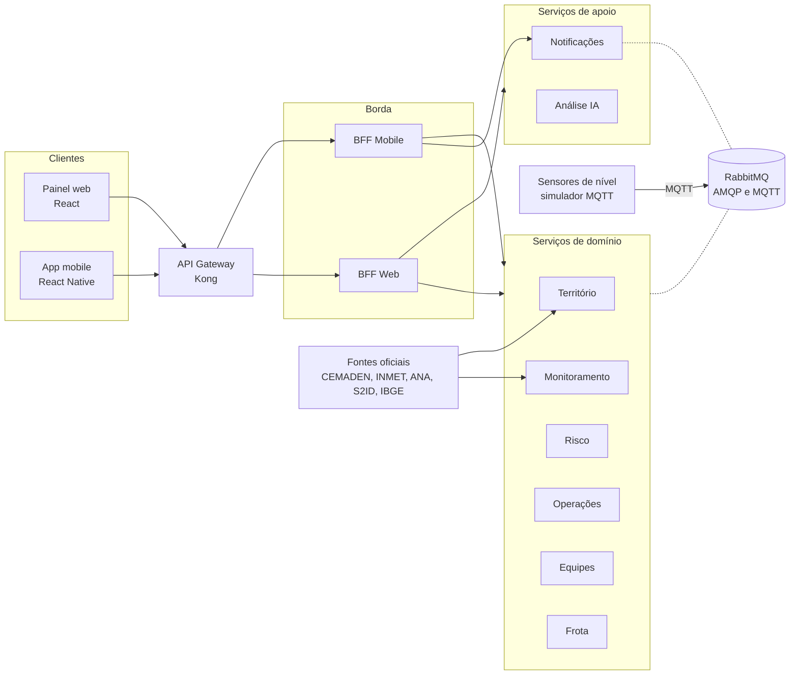

# Arquitetura da Pluvia

Documentação da **Parte 2** da disciplina GCC129. Descreve a decomposição em serviços, os contratos de API, os padrões de integração e as decisões técnicas da plataforma.

Nesta etapa não há sistema em execução. Os contratos e modelos definidos aqui orientam a implementação das Partes 3 e 4.

---

## Onde está cada item do enunciado

| Item | Tema | Documento |
|---|---|---|
| 4.1 | Decomposição em microsserviços | [01-decomposicao.md](01-decomposicao.md) |
| 4.2 | API REST, versionamento e HATEOAS | [02-api-rest.md](02-api-rest.md) e contratos OpenAPI em [`../api`](../api) |
| 4.3 | API Gateway e roteamento | [03-gateway.md](03-gateway.md) |
| 4.4 | Backend for Frontend | [04-bff.md](04-bff.md) |
| 4.5 | Database per service, consistência eventual e outbox | [05-dados.md](05-dados.md) |
| 4.6 | SAGA | [06-saga.md](06-saga.md) |
| 4.7 | CQRS | [07-cqrs.md](07-cqrs.md) |
| Apoio | Catálogo de eventos, comandos e contrato de sensores | [08-eventos.md](08-eventos.md) |
| Apoio | Registro de decisões técnicas | [09-decisoes.md](09-decisoes.md) |

---

## Visão geral

Setas contínuas representam chamadas HTTP síncronas. Linhas pontilhadas representam troca de mensagens assíncronas pelo broker. O detalhamento de quem fala com quem está em [01-decomposicao.md](01-decomposicao.md).

---

## Stack

| Camada | Tecnologia |
|---|---|
| Serviços de domínio, Notificações e BFFs | NestJS (TypeScript) |
| Serviço de Análise | Python com FastAPI e LangChain |
| Bancos de dados | PostgreSQL, uma instância por serviço, com extensões por necessidade: PostGIS, TimescaleDB e pgvector |
| Mensageria | RabbitMQ, com plugin MQTT para os sensores |
| API Gateway | Kong, em modo declarativo |
| Identidade | Keycloak, emitindo JWT |
| Cliente web | React |
| Cliente mobile | React Native com Expo |
| Contratos | OpenAPI 3.0 |
| Diagramas | Mermaid |

---

## Convenções gerais

- **Serviços de domínio não se chamam entre si por HTTP.** Toda integração entre eles acontece por mensagens. A única exceção é o serviço de Análise, justificada em [01-decomposicao.md](01-decomposicao.md).
- **Cada serviço é dono exclusivo do seu banco.** Nenhum serviço lê ou escreve no banco de outro.
- **Clientes só falam com o gateway, e o gateway só fala com os BFFs.** Serviços de domínio não são expostos externamente.
- **Nomes de recursos, campos e eventos em português, sem acentos**, para manter coerência com o domínio e com a documentação.
- **Datas em ISO 8601, em UTC. Identificadores em UUID.**
