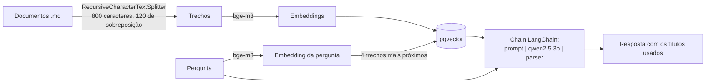

# RAG, LangChain e LLM como serviço distribuído

Serviço: [`services/analise`](../../services/analise). Medições feitas em 25/11/2026, num notebook com CPU de 12 threads, **sem GPU**, com o Ollama em container.

| Item | Escolha | Onde |
|---|---|---|
| Modelo de geração | `qwen2.5:3b` no Ollama (local, sem retenção de dados) | `services/analise/llm.env` |
| Modelo de embeddings | `bge-m3` (1024 dimensões, multilíngue) | `services/analise/llm.env` |
| Base vetorial | PostgreSQL com pgvector, índice HNSW por cosseno | `app/base_conhecimento.py` |
| Base de conhecimento | 5 documentos próprios do domínio, em 16 trechos | `services/analise/conhecimento/` |

---

## Pipeline do RAG



1. **Ingestão:** na subida, o serviço indexa a pasta `conhecimento/`. Um documento já indexado com o mesmo conteúdo (hash SHA-256) é ignorado. `POST /v1/documentos` indexa um texto a partir de uma URL.
2. **Embeddings:** feitos pelo `OllamaEmbeddings` do LangChain.
3. **Armazenamento:** a tabela `trechos` tem a coluna `embedding vector(1024)` e o índice HNSW.
4. **Recuperação:** a classe `RecuperadorPluvia` é um `BaseRetriever` do LangChain e devolve os 4 trechos mais próximos pela distância de cosseno.
5. **Geração:** a chain `PROMPT_COM_RECUPERACAO | modelo | StrOutputParser` gera a resposta. O prompt manda responder **só com o contexto** e dizer quando a base não cobre o assunto.

---

## Avaliação: com e sem recuperação

São 6 perguntas: 5 sobre o domínio e 1 fora do escopo, para testar se o modelo recusa. Cada uma foi feita duas vezes, sem cache: uma só com o modelo e outra com o RAG. O critério objetivo é a quantidade de fatos esperados que aparecem na resposta. As respostas completas estão em [`avaliacao-rag-bruta.md`](avaliacao-rag-bruta.md).

Para reproduzir: `docker compose exec analise python -m app.avaliacao`

| # | Pergunta | Sem recuperação | Com recuperação |
|---|---|---|---|
| 1 | Percentil e janela do nível ATENCAO | ❌ 0/2. **Inventou** "percentil 90 em 1 hora" | ✅ 2/2. "Percentil 85, acumulado de 72 horas" |
| 2 | O que fazer em ALTA_ATENCAO | ⚠️ 1/2. Resposta genérica | ✅ 2/2. Prontidão e aviso à Defesa Civil |
| 3 | Por que não cancelar uma ação PENDENTE | ❌ 0/2. **Inventou** "implicações legais" | ✅ 2/2. A reserva está em andamento |
| 4 | Ocorrências e afetados em Lavras (1991 a 2025) | ❌ 0/2. Disse que não sabe | ✅ 2/2. 11 ocorrências e 3.077 afetados |
| 5 | Cuidados na limpeza depois do alagamento | ❌ 0/2. Genérico, sem proteção | ⚠️ 1/2. Luvas e botas, mas não citou o nome "leptospirose" |
| 6 | Plantio de café (fora do escopo) | ❌ Respondeu com segurança fora do domínio | ✅ "Base de conhecimento não cobre o assunto" |
| | **Total de fatos** | **1/11 (9%)** | **10/11 (91%)** |

**Análise:**
- **Sem recuperação, o modelo alucina com confiança.** Nas perguntas 1 e 3, ele inventou regras do Pluvia que não existem. Num sistema de prevenção, isso é pior do que não responder.
- **Com recuperação, as respostas seguem a base.** Os trechos certos vieram em primeiro lugar em todas as perguntas, com similaridade de cosseno entre 0,55 e 0,73.
- **A recusa funciona.** Fora do domínio (pergunta 6), a similaridade máxima foi de 0,35 e o modelo declarou que a base não cobre o assunto, em vez de inventar.
- **A falha da pergunta 5 é de síntese, não de recuperação:** o trecho com "leptospirose" foi recuperado, mas o modelo de 3B parafraseou como "doenças". Um modelo maior ou um prompt que peça citação literal resolveria, ao custo de mais latência.

---

## LLM como dependência remota falível

O enunciado pede pelo menos 2 mecanismos. **Os 4 estão implementados** e foram testados com o Ollama parado de verdade (`docker compose stop ollama`):

| Mecanismo | Implementação | Evidência medida |
|---|---|---|
| **Timeout** | 60 s por tentativa (`LLM_TIMEOUT_S`) | Nenhuma chamada fica pendurada |
| **Retry com backoff** | `with_retry` do LangChain, até 3 tentativas com backoff exponencial e jitter, só para falha de rede | A primeira consulta com o Ollama fora levou cerca de 20 s, contando as tentativas |
| **Circuit breaker** | Abre depois de 3 falhas seguidas, espera 30 s e testa de novo (`app/resiliencia.py`) | Com o circuito aberto, a consulta respondeu em **4 ms**, em vez de 20 s. Depois que o Ollama voltou: MEIO_ABERTO → uma chamada de teste → FECHADO |
| **Cache** | Por chave (modelo, modo e pergunta normalizada), TTL de 10 min, 256 entradas | A mesma pergunta respondeu em **0 ms** com `origem: CACHE`, contra 17 s gerando |
| **Fallback** | Sem o modelo, a resposta traz os trechos mais relevantes com `origem: FALLBACK`. Se o modelo de embeddings também cair, a busca passa a ser por palavras-chave no PostgreSQL (`buscaDegradada: true`) | Com o Ollama parado, 4 de 4 perguntas responderam com os trechos certos |

`GET /v1/llm` mostra o estado do circuito e quantas respostas há em cache, para acompanhar ao vivo na apresentação.

**Quando não há o que devolver:** com o modelo fora e nenhum trecho encontrado, a resposta é **503** em `problem+json`. O serviço não inventa resposta.

---

## Latência

Medida em 5 consultas novas e nas 12 chamadas da avaliação, sem cache.

| Etapa | Mediana | Observação |
|---|---|---|
| Recuperação (embedding da pergunta + busca no pgvector) | **67 ms** | A busca vetorial é desprezível |
| Geração com RAG | **16,9 s** | Domina o tempo total |
| Geração sem RAG | 5,8 s | O prompt é menor |
| Resposta do cache | **0 ms** | — |
| Fallback com o circuito aberto | **4 ms** | — |

**De onde vem o tempo** (uma chamada típica, medida no próprio Ollama):

| | Tokens | Tempo | Vazão |
|---|---|---|---|
| Entrada (prompt + 4 trechos) | 823 | 11,9 s | ~69 tokens/s |
| Saída (resposta) | 122 | 8,3 s | ~14,7 tokens/s |

O gargalo é **ler o contexto na CPU**: os 4 trechos quase triplicam a entrada. Para reduzir:
- **GPU:** reduz o tempo em uma ordem de grandeza.
- **Menos trechos ou trechos menores:** com `RAG_TRECHOS=2`, a entrada cai pela metade, mas o risco de perder o trecho certo aumenta.
- **Cache:** perguntas repetidas, frequentes num painel, custam zero.

O modelo ocupa cerca de **6,8 GB de RAM** com os dois modelos carregados. A máquina da apresentação precisa de pelo menos 12 GB livres para o Docker.

---

## Custo por operação

**Uma consulta com RAG ≈ 950 tokens:** cerca de 830 de entrada e 120 de saída, mais 1 embedding da pergunta.

### Local (configuração atual)
- **Custo por token: zero.** O custo é de infraestrutura: a máquina e a energia.
- **Capacidade de uma instância:** cerca de 17 s por consulta, processadas uma de cada vez, o que dá **~5.000 consultas por dia** com 24 h de uso contínuo.
- **Escala:** uma réplica a mais de Ollama soma a mesma capacidade. O cache reduz a carga real, porque o painel repete as mesmas perguntas.
- **Privacidade:** nenhum dado sai da infraestrutura do município, o que é coerente com a LGPD.

### Comparação com um provedor de API pago

```
custo por consulta = 830 × (preço por token de entrada) + 120 × (preço por token de saída)
custo por mês      = custo por consulta × consultas por dia × 30 × (1 − taxa de acerto do cache)
```

| Cenário | Consultas/dia | Tokens/mês, sem cache | Com 40% de cache |
|---|---|---|---|
| Piloto (1 município) | 200 | 5,7 milhões | 3,4 milhões |
| 10 municípios | 2.000 | 57 milhões | 34 milhões |

Os preços por token mudam com frequência e variam por provedor. Por isso o cálculo usa a fórmula, e o preço deve ser consultado na tabela oficial do provedor no dia da comparação. Com um provedor pago, os dados saem da infraestrutura, então é preciso escolher um que não retenha os dados enviados.

---

## Como demonstrar ao vivo (cerca de 3 minutos)

```bash
# 1. RAG: pergunta do domínio, com a resposta e os trechos usados
curl -X POST .../v1/consultas -d '{"pergunta":"Qual percentil faz uma região entrar em ATENCAO?"}'

# 2. Comparação: a mesma pergunta sem recuperação (o modelo inventa)
curl -X POST .../v1/consultas -d '{"pergunta":"...","usarRecuperacao":false}'

# 3. Cache: repetir a pergunta 1, que volta com "origem":"CACHE" em ~0 ms

# 4. Falha: derrubar o modelo
docker compose stop ollama
curl -X POST .../v1/consultas -d '{"pergunta":"O que fazer em alta atenção?"}'  # FALLBACK
curl .../v1/llm   # "circuito":"ABERTO"

# 5. Recuperação
docker compose start ollama   # depois de 30 s: MEIO_ABERTO, depois FECHADO
```
