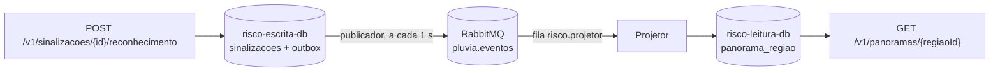

# Serviço de Risco

Criado a partir de [`templates/servico-nestjs`](../../templates/servico-nestjs/README.md), que descreve as camadas, a regra de dependência e os testes. Este README cobre só o que muda no Risco.

O Risco aplica CQRS ([07-cqrs.md](../../docs/arquitetura/07-cqrs.md)), então tem **duas instâncias de PostgreSQL**:

| Instância | Host no compose e no Kubernetes | Conteúdo |
| --------- | ------------------------------- | -------- |
| Escrita | `risco-escrita-db` | Modelo normalizado: sinalizações e parâmetros de avaliação |
| Leitura | `risco-leitura-db` | Panorama desnormalizado, um documento JSONB por região |

Cada instância tem banco, usuário, senha, volume, rede e healthcheck próprios. O serviço é o único container nas duas redes de dados.

## O que muda em relação ao modelo

- **Duas conexões do TypeORM**, chamadas `escrita` e `leitura` (`BANCO_ESCRITA` e `BANCO_LEITURA` em `infra/db/conn/data-source.ts`). Para usar uma delas, injete com `@InjectDataSource(BANCO_ESCRITA)` ou `@InjectRepository(Entidade, BANCO_LEITURA)`.
- **Entidades e migrations separadas por banco**, em `infra/db/escrita/` e `infra/db/leitura/`. Uma conexão nunca carrega as entidades da outra.
- **`GET /health` verifica os dois bancos.** Responde 200 só com os dois `up`; se um cair, responde 503 e o corpo diz qual:

  ```json
  {"status":"error","info":{"escrita":{"status":"up"}},"error":{"leitura":{"status":"down"}}}
  ```

## Configuração

| Variável | Origem no compose | Uso |
| -------- | ----------------- | --- |
| `POSTGRES_ESCRITA_HOST`, `POSTGRES_LEITURA_HOST` | `environment` | host de cada banco |
| `POSTGRES_ESCRITA_PORT`, `POSTGRES_LEITURA_PORT` | `environment` | porta de cada banco |
| `POSTGRES_ESCRITA_DB`, `POSTGRES_LEITURA_DB` | `.env` | nome de cada banco |
| `POSTGRES_ESCRITA_USER`, `POSTGRES_LEITURA_USER` | `.env` | usuário de cada banco |
| `POSTGRES_ESCRITA_PASSWORD`, `POSTGRES_LEITURA_PASSWORD` | `.env` | senha de cada banco |
| `RABBITMQ_HOST`, `RABBITMQ_PORT`, `RABBITMQ_VHOST` | `environment` | onde está o broker (`rabbitmq:5672`, vhost `pluvia`) |
| `RABBITMQ_USER`, `RABBITMQ_PASSWORD` | `.env` | os mesmos `RABBITMQ_SERVICOS_*` de `infra/rabbitmq/.env`. No Kubernetes vêm do `rabbitmq-secret` |
| `PORT` | `environment` | porta HTTP do serviço |

Os containers dos bancos usam as variáveis padrão da imagem (`POSTGRES_DB`, `POSTGRES_USER`, `POSTGRES_PASSWORD`). O `compose.yaml` as preenche a partir do `.env` por interpolação (`${POSTGRES_ESCRITA_PASSWORD}`), então a senha só existe no `.env`. Se faltar alguma, o `docker compose` para e diz qual.

## Subir

```bash
cp services/risco/.env.example services/risco/.env   # troque as senhas dos bancos
cp infra/rabbitmq/.env.example infra/rabbitmq/.env   # se ainda não existir
# RABBITMQ_USER/RABBITMQ_PASSWORD do Risco = RABBITMQ_SERVICOS_* do RabbitMQ
docker compose up -d --build --wait rabbitmq risco
docker compose ps
```

Os três containers (`risco`, `risco-escrita-db` e `risco-leitura-db`) devem ficar `healthy`. Para conferir:

```bash
docker compose exec risco wget -qO- 127.0.0.1:3000/health
```

## CQRS: como funciona



1. **Comando** (`src/@core/use-cases/sinalizacoes.ts`): numa transação só do banco de escrita, muda a sinalização para `RECONHECIDA` e grava o envelope `SinalizacaoReconhecida` na tabela `outbox`.
2. **Publicador da outbox** (`src/infra/mensageria/publicador-outbox.ts`): a cada 1 s pega até 50 registros com `publicado_em IS NULL`, publica no exchange `pluvia.eventos` com confirmação do broker e marca `publicado_em`.
3. **Projetor** (`src/infra/mensageria/consumidor-projetor.ts` e `src/@core/use-cases/projetar-evento.ts`): consome `risco.projetor`, grava o `id` do evento em `mensagens_processadas`, troca o estado da sinalização no `documento` do panorama e soma 1 em `versao`, tudo numa transação do banco de leitura. Só então dá o `ack`. No log aparece a defasagem: `Panorama ... na versão 2 ... (defasagem 473 ms)`.
4. **Consultas**: `GET /v1/panoramas` e `GET /v1/panoramas/{regiaoId}` leem do banco de **leitura**. `GET /v1/sinalizacoes` e `GET /v1/sinalizacoes/{id}` leem do banco de **escrita**, para o técnico ver na hora o que acabou de fazer.

| Endpoint | Banco | Tipo |
| -------- | ----- | ---- |
| `POST /v1/sinalizacoes/{id}/reconhecimento` | escrita | comando: 200, 404 ou 409 em problem+json |
| `GET /v1/sinalizacoes`, `GET /v1/sinalizacoes/{id}` | escrita | consulta (filtros `estado`, `regiaoId`, `origem`) |
| `GET /v1/panoramas` | leitura | consulta, do nível mais grave para o mais leve |
| `GET /v1/panoramas/{regiaoId}` | leitura | consulta, documento pronto da região |

O seed tem as 5 regiões de Lavras (mesmos UUIDs do Território) e uma sinalização `ABERTA` de nível `ATENCAO` no Centro, com id fixo `7a3e5b20-0000-4000-8000-000000000001`.

## Roteiro da demo

O Kong hoje só roteia para os BFFs. A rota pública do Risco ainda precisa ser combinada com o Lucas; quando existir, troque `RISCO` abaixo por `http://localhost:8000/<rota>`. Até lá, a demo chama o serviço por dentro da rede do compose:

```bash
RISCO='docker compose exec -T risco wget -qO-'
CENTRO=6f1c2a10-0000-4000-8000-000000000001
SINALIZACAO=7a3e5b20-0000-4000-8000-000000000001

# 1. Panorama do Centro (banco de LEITURA): sinalização ABERTA, versao 1
$RISCO http://127.0.0.1:3000/v1/panoramas/$CENTRO; echo

# 2. Reconhecer (banco de ESCRITA)
$RISCO --post-data='' http://127.0.0.1:3000/v1/sinalizacoes/$SINALIZACAO/reconhecimento; echo

# 3. Panorama de novo, um ou dois segundos depois: RECONHECIDA, versao 2
$RISCO http://127.0.0.1:3000/v1/panoramas/$CENTRO; echo
#    "A escrita foi num banco e a leitura em outro; quem sincronizou foi o evento."

# 4. Os dois bancos separados
docker compose ps risco-escrita-db risco-leitura-db

# Extra: a defasagem medida pelo projetor
docker compose logs risco | grep defasagem
```

Para repetir a demo do zero, recrie só os bancos do Risco (isso apaga os dados deles): `docker compose rm -sfv risco-escrita-db risco-leitura-db && docker volume rm pluvia_risco-escrita-db-dados pluvia_risco-leitura-db-dados && docker compose up -d --wait risco`.

**Demo extra de resiliência (outbox):** `docker compose stop rabbitmq`, reconheça uma sinalização (responde 200 mesmo assim), mostre que o panorama não mudou, `docker compose start rabbitmq` e mostre o panorama atualizado. O evento esperou na outbox.

## Arguição

- **Por que CQRS no Risco?** O painel lê muito mais do que se escreve, e a leitura junta dados de vários serviços. O panorama fica pronto no banco de leitura, sem cálculo nem junção na hora da consulta. Escrita e leitura escalam e mudam de formato separadamente.
- **Qual a defasagem?** Poucos segundos no pior caso: até 1 s do ciclo do publicador, mais o tempo do RabbitMQ e da transação do projetor. Medido aqui em cerca de 0,5 s. O documento aceita até 30 s. Cada panorama traz `atualizadoEm` e `versao` para o cliente saber a idade do dado.
- **Por que a outbox?** Sem ela, gravar no banco e publicar no RabbitMQ são duas operações separadas (*dual write*): se o serviço cair no meio, o evento se perde e a leitura nunca é atualizada. Com a outbox, o evento é gravado na mesma transação da mudança.
- **E se o RabbitMQ cair?** O comando continua respondendo 200. O evento fica na outbox e é publicado quando o broker voltar.
- **E se o projetor cair?** A mensagem fica na fila e é processada quando ele voltar. O `ack` só acontece depois de gravar.
- **E se a mesma mensagem chegar duas vezes?** A entrega é "pelo menos uma vez". O projetor grava o `id` do envelope em `mensagens_processadas` na mesma transação da atualização. Se o `id` já estiver lá, ignora.
- **E com duas réplicas do Risco?** O publicador usa `FOR UPDATE SKIP LOCKED`, então cada registro da outbox é publicado por uma réplica só.

## Testes

```bash
npm ci
npm test
```

Precisa de Docker rodando. São dois testes e2e com Testcontainers:

- `test/health.e2e-spec.ts` sobe dois `postgres:17-alpine` e derruba cada um deles para conferir que o `/health` aponta o banco certo e se recupera sem reiniciar a aplicação.
- `test/cqrs.e2e-spec.ts` sobe os dois Postgres e um RabbitMQ com a topologia do `infra/rabbitmq/definitions.json`. Confere o panorama do Centro com a sinalização `ABERTA`, reconhece, e espera até 5 s, perguntando de novo a cada 200 ms, até o panorama mostrar `RECONHECIDA` com a `versao` maior.
